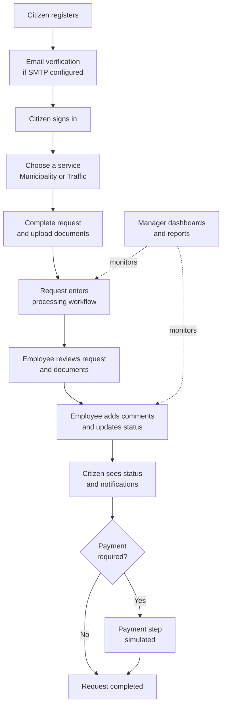
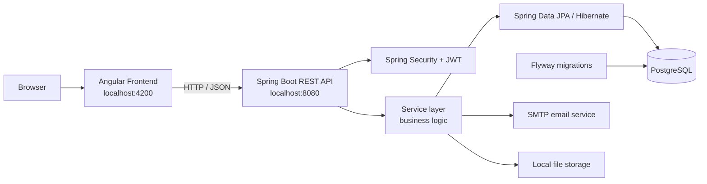

<div align="center">

# GovFlow Tracker

### A Full-Stack Platform for Digitizing Government Service Workflows

Citizens submit. Employees process. Managers oversee. One platform, one workflow.


</div>

> [!IMPORTANT]
> **Educational / demo prototype.** GovFlow Tracker is a simulation and is **not connected to any real government entity**. All citizen records, service requests, and payments are simulated. Do **not** use it to process real citizen data or real payments.

---

## Table of Contents

- [Overview](#overview)
- [The Problem and the Solution](#the-problem-and-the-solution)
- [Business Value](#business-value)
- [User Roles](#user-roles)
- [Key Features](#key-features)
- [End-to-End Workflow](#end-to-end-workflow)
- [Technology Stack](#technology-stack)
- [Architecture](#architecture)
- [Project Structure](#project-structure)
- [Getting Started](#getting-started)
- [Database and Migrations](#database-and-migrations)
- [Security Notes](#security-notes)
- [Testing and Build](#testing-and-build)
- [Troubleshooting](#troubleshooting)
- [User Guide](#user-guide)
- [Scope and Limitations](#scope-and-limitations)
- [Roadmap](#roadmap)
- [Authors](#authors)
- [Disclaimer](#disclaimer)

---

## Overview

GovFlow Tracker is a full-stack web application that demonstrates how common government services can be moved onto a single, role-based digital platform. It connects **citizens**, **service employees**, and **managers** in one workflow covering:

- Account registration and email verification
- Service request submission
- Supporting document upload and review
- Status updates and employee comments
- Notifications
- Payment tracking
- Operational dashboards and reports

The project covers two service domains: **Municipality** (e.g. building permits, complaints) and **Traffic** (e.g. driver's licenses, vehicle-related services).

## The Problem and the Solution

| Typical challenge in manual or fragmented processes | How GovFlow Tracker addresses it |
|---|---|
| Citizens can't tell where their request stands | Request status tracking, detail views, and notifications |
| Paper documents and scattered attachments | Centralized document upload and review per request |
| Work is not clearly assigned to staff | Employee task views based on the service-request workflow |
| No visibility for management | Manager dashboards and performance reports |
| Payment status is unclear | Payment history and request-level payment/invoice fields |
| Mixed responsibilities and access | Separate citizen, employee, and manager experiences via Angular guards and Spring Security |

## Business Value

| Business need | Capability |
|---|---|
| **Transparency** | Citizens see request status, comments, and notifications in one place |
| **Structured processing** | Requests are organized by service type, department, and employee workflow |
| **Document handling** | Supporting documents are attached to and reviewed within the request |
| **Communication** | In-platform comments and notifications tied to each request |
| **Payment visibility** | Payment information and history available to the citizen |
| **Operational oversight** | Manager dashboards with request and employee performance metrics |
| **Role separation** | Distinct experiences and backend security rules per role |

> These are intended capabilities of the prototype. They are not claims of production deployment or independently verified operational results.

## User Roles

| Capability | Citizen | Employee | Manager |
|---|:---:|:---:|:---:|
| Register, verify email, sign in | ✅ | ✅ (employee/manager login flow) | ✅ (employee/manager login flow) |
| Submit service requests and upload documents | ✅ | | |
| Track request status, comments, notifications | ✅ | | |
| View payment information and history | ✅ | | |
| Manage profile and recover password | ✅ | | |
| View assigned tasks and request details | | ✅ | |
| Review attached documents | | ✅ | |
| Update request status and comment for citizens | | ✅ | |
| Dashboards and reports (requests, departments) | | | ✅ |
| Employee performance review | | ✅ (own interface) | ✅ |
| Employee management (creation/registration flows) | | | ✅ |

> The exact permissions depend on the implemented backend security rules and should be validated when deploying or extending the project.

## Key Features

### Account and Access Management
- Registration and login screens with role-aware navigation
- Angular route guards on the frontend
- JWT-based authentication in the backend
- Email verification and password-reset flows
- Profile and password-management pages

### Government Service Requests
- **Municipality:** building permit and complaint-related flows
- **Traffic:** driver's license and vehicle-related flows
- Request status tracking and request-detail views
- Employee review and status-update workflow
- Comments attached to requests

### Documents and Notifications
- Document upload with a file-storage service
- Request document listing and review
- Notification pages and notification service

### Payments
- Payment screens, payment records, and payment history
- Payment status and invoice-related fields on requests
- Payment is **simulated**; no live payment gateway is integrated

### Dashboards and Reporting
- Citizen dashboard with request summaries and shortcuts
- Employee dashboard and task views
- Manager dashboard and reporting views
- Request and employee performance charts

### Help and Support
- In-app help center with role-oriented FAQs, search, and category filters
- Separate illustrated [user guide](#user-guide)

## End-to-End Workflow



## Technology Stack

> Versions are taken from the supplied project configuration. Confirm installed versions and environment settings before running the project.

### Frontend

| Technology | Purpose |
|---|---|
| **Angular 20** + **TypeScript** | Single-page application and typed component-based UI |
| **Angular Router / Forms** | Navigation, route configuration, form handling and validation |
| **Angular Material / CDK** | UI components and interaction utilities |
| **RxJS** | Reactive and asynchronous data flows |
| **@ngx-translate** | Translation infrastructure |
| **@swimlane/ngx-charts** | Dashboard and report charts |
| **jwt-decode** | Reading JWT data on the client |
| **jsPDF, html2canvas, file-saver** | PDF / export utilities |
| **Karma + Jasmine** | Frontend unit-test tooling |

### Backend

| Technology | Purpose |
|---|---|
| **Java 23** | Backend language (per `pom.xml`) |
| **Spring Boot 3.3.4** | Application framework |
| **Spring Web** | REST API |
| **Spring Security + JJWT 0.11.5** | Authentication and authorization |
| **Spring Data JPA + Hibernate** | Persistence and ORM |
| **Bean Validation** | Request and data validation |
| **Flyway** | Versioned database migrations |
| **Spring Boot Starter Mail** | Email workflows |
| **Spring Boot Actuator** | Monitoring endpoints support |
| **Lombok** | Boilerplate reduction |
| **Maven + Maven Wrapper** | Build and dependency management |
| **JUnit / Spring Boot Test** | Backend test tooling |

### Data and Supporting Services

| Component | Role |
|---|---|
| **PostgreSQL** | Stores users, departments, service requests, documents, payments, comments, and notifications |
| **Flyway SQL migrations** | Schema versioning and seed/configuration data |
| **SMTP (Gmail config in `application.yaml`)** | Email verification and password reset, when valid credentials are supplied |
| **Local file storage** | Uploaded documents (`./uploads`) |

## Architecture



### Backend layering

| Layer | Responsibility |
|---|---|
| **Controllers** | HTTP endpoints for authentication, citizens, employees, managers, services, documents, payments, profiles, notifications, and traffic services |
| **DTOs** | Request/response data exchanged through the API |
| **Entities** | Persisted domain data |
| **Repositories** | Database access |
| **Services** | Application workflows and business operations |
| **Security** | JWT processing, security configuration, web configuration |
| **Exception handling** | Centralized application error handling |

### Frontend organization

The Angular app separates shared components, route guards, interfaces, pages, and API-facing services. Pages are organized around citizen, employee, and manager workflows; services encapsulate backend calls.

## Project Structure

```text
GovFlow-Tracker/
├── GovFlow-Tracker-Backend-main/
│   ├── src/main/java/com/example/backend/govflow/
│   │   ├── controller/
│   │   ├── dto/
│   │   ├── entity/
│   │   ├── exception/
│   │   ├── repository/
│   │   ├── security/
│   │   ├── service/
│   │   └── BackendApplication.java
│   ├── src/main/resources/
│   │   ├── db/migration/
│   │   └── application.yaml
│   ├── src/test/
│   ├── pom.xml
│   ├── mvnw
│   └── mvnw.cmd
│
├── GovFlow-Tracker-Frontend-main/
│   ├── src/app/
│   │   ├── components/
│   │   ├── directives/
│   │   ├── guards/
│   │   ├── interfaces/
│   │   ├── pages/
│   │   ├── services/
│   │   └── app.routes.ts
│   ├── src/assets/
│   ├── angular.json
│   ├── package.json
│   └── package-lock.json
│
└── docs/
    └── GovFlow-User-Guide.pdf
```

## Getting Started

### Prerequisites

| Requirement | Notes |
|---|---|
| **JDK 23** | Matches the backend compiler configuration |
| **Node.js + npm** | Compatible with the Angular 20 toolchain |
| **PostgreSQL** | Local or reachable via a configured URL |
| **Terminal** | PowerShell, Command Prompt, or a Unix shell |
| **Git** | If cloning the repository |

A separate Maven installation is usually not required; the Maven Wrapper is included.

### 1. Create the database

Create a PostgreSQL database named `GovFlow_Tracker` (or use another name and adjust `DB_URL`).

Default JDBC URL in `application.yaml`:

```text
jdbc:postgresql://localhost:5432/GovFlow_Tracker
```

### 2. Set environment variables

| Variable | Description |
|---|---|
| `DB_URL` | JDBC URL of the PostgreSQL database |
| `DB_USERNAME` | Database username |
| `DB_PASSWORD` | Database password |
| `MAIL_USERNAME` | SMTP account (Gmail in the supplied config) |
| `MAIL_PASSWORD` | SMTP password / Gmail app password |
| `JWT_SECRET` | Long, random signing secret |

**Windows PowerShell**

```powershell
$env:DB_URL="jdbc:postgresql://localhost:5432/GovFlow_Tracker"
$env:DB_USERNAME="postgres"
$env:DB_PASSWORD="YOUR_POSTGRES_PASSWORD"

$env:MAIL_USERNAME="your-email@gmail.com"
$env:MAIL_PASSWORD="YOUR_GMAIL_APP_PASSWORD"

$env:JWT_SECRET="REPLACE_WITH_A_LONG_RANDOM_SECRET"
```

**macOS / Linux**

```bash
export DB_URL="jdbc:postgresql://localhost:5432/GovFlow_Tracker"
export DB_USERNAME="postgres"
export DB_PASSWORD="YOUR_POSTGRES_PASSWORD"

export MAIL_USERNAME="your-email@gmail.com"
export MAIL_PASSWORD="YOUR_GMAIL_APP_PASSWORD"

export JWT_SECRET="REPLACE_WITH_A_LONG_RANDOM_SECRET"
```

> [!WARNING]
> Replace every placeholder with your own values. Never commit credentials, app passwords, or JWT secrets to Git. Email-dependent flows will not work until SMTP credentials are valid.

### 3. Default application settings

| Setting | Value |
|---|---|
| Backend port / base URL | `8080` / `http://localhost:8080` |
| Frontend URL | `http://localhost:4200` |
| File upload directory | `./uploads` |

If you change a port or URL, update the related backend and frontend configuration consistently, including CORS/security settings.

### 4. Run the backend

```powershell
cd GovFlow-Tracker-Backend-main
.\mvnw.cmd spring-boot:run
```

macOS / Linux:

```bash
cd GovFlow-Tracker-Backend-main
./mvnw spring-boot:run
```

Watch the console for errors related to database connectivity, Flyway migrations, missing environment variables, SMTP configuration, or port conflicts.

### 5. Run the frontend

In a **second terminal**:

```bash
cd GovFlow-Tracker-Frontend-main
npm ci
npm start
```

If `npm ci` fails because the lockfile is unavailable or inconsistent, review the dependency state before falling back to `npm install`. Then open `http://localhost:4200`.

### 6. Try it out

1. Open the home page.
2. Register a demo account (or use one from your project setup).
3. Complete email verification if SMTP is configured.
4. Sign in using the appropriate role flow.
5. Submit a sample service request and review its details and status.
6. Test document upload, comments, notifications, and payment screens.

> Do not assume a particular demo account exists unless it is documented in the seed scripts or provided separately. Use only simulated data.

## Database and Migrations

Migration scripts live in `GovFlow-Tracker-Backend-main/src/main/resources/db/migration/`:

| Migration | Purpose |
|---|---|
| `V1__initial_schema_and_data.sql` | Initial schema and data |
| `V2__Add_Fee_To_Requests.sql` | Fee field on requests |
| `V3__Add_Predefined_Employees_And_Managers.sql` | Predefined employees and managers |
| `V4__Add_Employee_ID_And_Task_Distribution_Fields.sql` | Employee ID and task-distribution fields |
| `V5__Enhance_Manager_Structure.sql` | Enhanced manager structure |

Flyway applies pending migrations at startup. Hibernate runs with `ddl-auto: validate`, so it checks mappings against the schema instead of creating it. Back up any existing database before running against data you need to preserve.

## Security Notes

This is a demonstration project, not a production-ready government platform. Before any real-world deployment:

- Move secrets to managed secret storage.
- Review JWT secret strength, token expiry, revocation, and storage.
- Enforce authorization on every protected backend endpoint and validate role permissions.
- Validate uploaded file types, sizes, names, storage paths, and download permissions.
- Configure HTTPS, strict CORS origins, logging, monitoring, backups, and recovery.
- Review privacy, data retention, accessibility, and applicable legal requirements.
- Integrate a real payment provider only if required, with its security and reconciliation needs.
- Make sure all seeded/demo records are synthetic before sharing the repository.

## Testing and Build

| Task | Command | Location |
|---|---|---|
| Backend tests | `./mvnw test` (`.\mvnw.cmd test` on Windows) | Backend directory |
| Frontend tests | `npm test` (Karma + Jasmine) | Frontend directory |
| Production frontend build | `npm run build` | Frontend directory |

The backend currently includes a Spring Boot context-load test. Passing it does not prove every API endpoint or user workflow works. A successful frontend build does not replace integration testing across Angular, Spring Boot, PostgreSQL, SMTP, and file storage.

## Troubleshooting

| Symptom | What to check |
|---|---|
| Backend fails at startup with a database error | PostgreSQL is running, the `GovFlow_Tracker` database exists, and `DB_URL` / `DB_USERNAME` / `DB_PASSWORD` are set in the same terminal |
| Flyway or schema validation error | Review Flyway logs and database state; do not delete migration history or drop data without a backup |
| Missing property / secret error | All environment variables from the table above are set |
| Verification or reset emails are not sent | Valid SMTP credentials (Gmail app password if required) |
| Port already in use | Free ports `8080` / `4200`, or change them consistently in backend and frontend config |
| Frontend cannot reach the API | Backend is running and CORS/security settings match the frontend URL |
| `npm ci` fails | Check Node.js/npm versions and the lockfile before using `npm install` |

## User Guide

An illustrated guide covers the main screens and journeys: registration, email verification, login, password recovery, citizen requests, request details, payment pages, profile settings, employee tasks, manager reporting, and employee management.

**[📄 Open the User Guide](docs/User Guide-GOV.pdf)**

> Place the PDF at `docs/User Guide-GOV.pdf` for the link to work on GitHub.

## Scope and Limitations

- Documented as a prototype/simulation; not connected to a real government entity.
- Citizen information, requests, and payments are simulated.
- Payment UI and models do not imply a real payment gateway.
- Email features require valid SMTP configuration.
- Uploads use local storage; production-grade object storage and retention controls are not implied.
- Runtime behavior, endpoint coverage, deployment readiness, and end-to-end test coverage must be verified in the target environment.

## Roadmap

- [ ] OpenAPI/Swagger API documentation
- [ ] Broader unit, integration, and end-to-end test coverage
- [ ] CI workflows for build, test, and static analysis
- [ ] Containerization (frontend, backend, database) for repeatable setup
- [ ] Centralized logging, metrics, health checks, and alerting
- [ ] Production file storage, malware scanning, and document-retention policies
- [ ] Payment provider integration in a test environment (if in scope)
- [ ] Accessibility, localization validation, and responsive UI testing
- [ ] Documentation of API endpoints, role permissions, environment variables, and troubleshooting

## Authors

GovFlow Tracker was built by a team of three:

**Omar Mostafa**

**Omar Yasser**

**Youssef Atef**

*Full-Stack Development | Java, Spring Boot, Angular, PostgreSQL*

If you use or extend this project, please review the code and configuration carefully before deployment.

## Disclaimer

GovFlow Tracker is an educational/demo prototype intended to demonstrate a digital government-service workflow. It is not an official government service, does not establish a connection to any government authority, and must not be represented as accepting real applications or real payments.